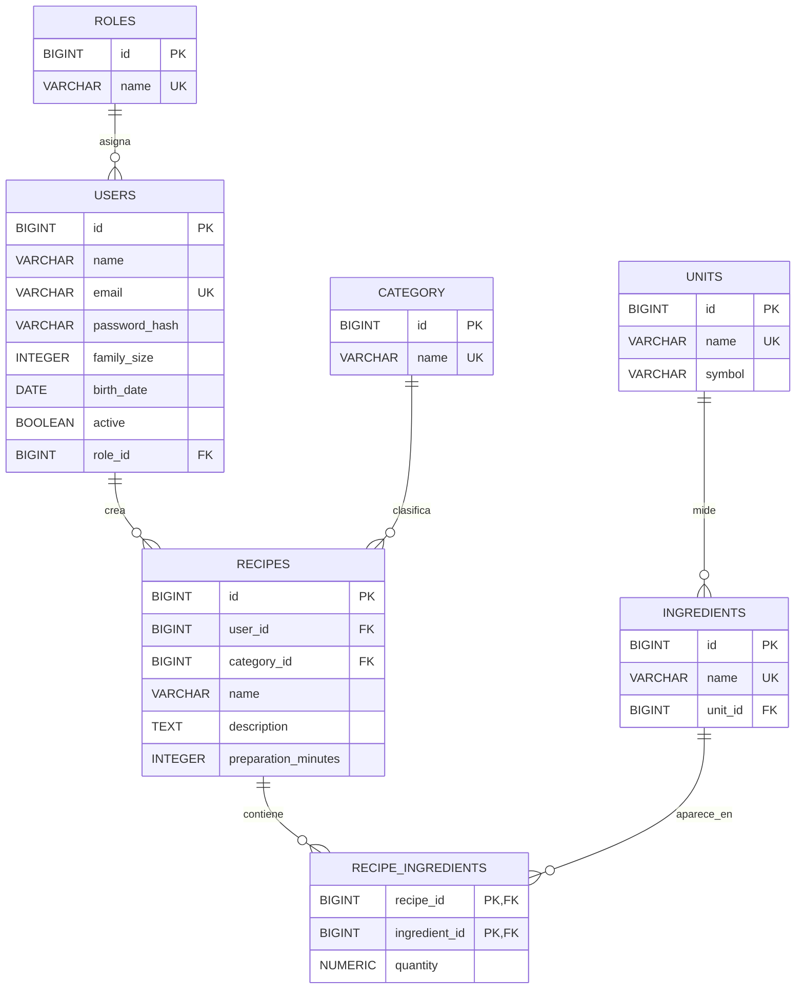

# Modelo Entidad-Relación — Cook-List

**Proyecto:** Cook-List  
**Módulo:** Proyecto Intermodular (0379 · PIDW2) — 2.º DAW
**Centro:** CIFP Avilés — Curso 2026/2027  
**Autor/a:** Mabel Zárate Espíritu

## 1. Diagrama Entidad-Relación

## 2. Entidades y relaciones principales

- **ROLES — USERS (1:N):** un rol puede estar asignado a varios usuarios. Cada usuario tiene un rol.
- **USERS — RECIPES (1:N):** un usuario puede crear varias recetas. Cada receta pertenece a un usuario.
- **CATEGORY — RECIPES (1:N):** una categoría puede clasificar varias recetas. Cada receta pertenece a una categoría.
- **UNITS — INGREDIENTS (1:N):** una unidad de medida puede utilizarse en varios ingredientes. Cada ingrediente tiene una unidad de referencia.
- **RECIPES — INGREDIENTS (M:N):** una receta puede contener varios ingredientes y un ingrediente puede utilizarse en varias recetas. Esta relación se resuelve mediante `RECIPE_INGREDIENTS`.

La tabla `RECIPE_INGREDIENTS` utiliza una clave primaria compuesta por `recipe_id` e `ingredient_id`. Ambos campos son también claves foráneas. El atributo `quantity` almacena la cantidad del ingrediente utilizada en la receta.

## 3. Justificación de la tercera forma normal (3FN)

El modelo se diseña para cumplir la tercera forma normal, siguiendo estos criterios:

1. **Primera forma normal (1FN):** cada campo contiene un único valor atómico y no existen grupos repetitivos de ingredientes dentro de una receta. Los ingredientes se almacenan en registros separados de `RECIPE_INGREDIENTS`.

2. **Segunda forma normal (2FN):** las entidades con claves primarias simples cumplen la 2FN al depender sus atributos de su clave completa. En `RECIPE_INGREDIENTS`, el atributo `quantity` depende de la combinación de `recipe_id` e `ingredient_id`, y no de una sola parte de la clave.

3. **Tercera forma normal (3FN):** los atributos descriptivos se almacenan en sus entidades correspondientes. Los nombres de los roles, las categorías y las unidades se mantienen en sus propias tablas y se referencian mediante claves foráneas. De este modo se evitan dependencias transitivas entre los atributos no clave.

La unidad de referencia de cada ingrediente se guarda en `INGREDIENTS`. Como la conversión automática de unidades queda fuera del MVP, las cantidades de las recetas se interpretarán utilizando la unidad definida para cada ingrediente.

